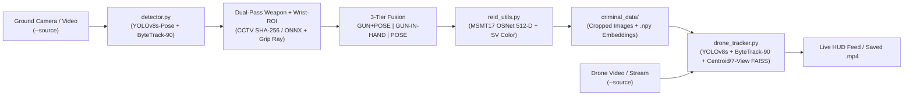

# Real-Time Suspect Detection & Aerial Tracking System


A two-stage computer vision and person re-identification (Re-ID) pipeline: fixed ground cameras combine **YOLOv8s-Pose + ByteTrack** with a **security-audited CCTV firearm detector** (Full-Frame + Pose-Guided Wrist-ROI zoom & forearm grip-ray attribution) to confirm armed threats in **< 0.13 s** (`2` frames), extract **MSMT17 OSNet + Outfit Color** descriptors, and hand them off to an aerial **YOLOv8s + ByteTrack-90 + FAISS** tracker that continuously locks onto suspects across camera cuts and occlusions.

---

## Architecture



---

## Repository Structure

```
Suspect-drone-tracker/
├── detector.py            # Ground camera Dual-Pass Weapon + Pose + ByteTrack threat detector
├── drone_tracker.py       # Aerial YOLOv8s + ByteTrack-90 + Centroid/FAISS continuous tracker
├── reid_utils.py          # Shared MSMT17 OSNet, SHA-256/pickletools verifier, color & HUD utils
├── bytetrack_custom.yaml  # ByteTrack config with 90-frame occlusion buffer
├── tests/
│   └── test_fusion.py     # Offline unit tests for grip-ray math, pose rules, color & security
├── requirements.txt       # Python dependencies
├── .gitignore             # Ignores weights (.pt/.pth/.onnx), videos, cache, and criminal_data/
└── LICENSE                # Apache 2.0 License
```

---

## Key Capabilities

- **Ground Camera Pose + Gun-Keypoint Fusion (`detector.py`):**
  - Runs **YOLOv8s-Pose + ByteTrack** (`yolov8s-pose.pt`, `90`-frame buffer) alongside a **security-audited CCTV firearm detector** (`--weapon-model auto`: SHA-256 + `pickletools`-verified `cive202/weapon-detection-yolov8-cctv`, with `--weapon-model onnx` fallback to pickle-free `Hadi959/weapon-detection-yolov8`).
  - Runs **Dual-Pass Inference** (**Full-Frame + Pose-Guided Wrist-ROI Zoom**) so tiny distant firearms (`15–30 px` on CCTV) remain sharp, then attributes each gun (`<= 14%` person box area & `<= 45%` person height) 1-to-1 via **Forearm-Grip Ray Intersection** (`wrist` to projected barrel reach) for rapid sub-second confirmation:
    - `GUN+POSE` (`1`-frame instant lock on simultaneous strict pose + held weapon, or `2`-frame lock with ready stance)
    - `GUN-IN-HAND` (`--gun-confirm 2`, `0.07–0.13s` lock on waist/chest/downward/frontal holds without raised arms)
    - `POSE` (`--confirm-frames 4` in `--persistence 8`, strict aiming-pose fallback when small guns are occluded)
  - Deduplicates identities across camera cuts via OSNet Re-ID + outfit color, renders live per-person threat `%` + `ARMING` badges, and saves suspect crops + 512-D **OSNet (MSMT17)** embeddings to `criminal_data/` on a background thread.
- **Aerial Continuous Re-Identification (`drone_tracker.py`):**
  - Tracks people with **YOLOv8s + ByteTrack** (`90`-frame buffer) and scores **45% Centroid + 55% Max-View** similarity fusing **MSMT17 OSNet + FAISS** (`68%`) and **2D (S, V) + Hue outfit color** (`32%`).
  - **Continuous Lock Stability:** Uses locked-track querying, unlock patience (`--unlock-patience 6`), spatial re-attach after brief occlusions, and **quality-aware 7-view gallery replacement** (with slot `#0` permanently pinned to the ground threat frame).
- **Cross-Platform & Headless Ready:**
  - Supports local `.mp4` files, live webcams (`--source 0`), `--save-video`, and `--no-display` for headless servers.
  - Auto-downloads, verifies (SHA-256 + `pickletools`), and caches official **OSNet MSMT17** Re-ID weights, CCTV weapon weights (`--weapon-model auto` / `onnx` / `none`), and YOLOv8 weights.

---

## Complementary 3-Tier Threat Fusion & Benchmark (CPU, `testvideo.mp4`)

| Tier | Trigger Condition | Lock Speed | What It Catches |
|---|---|---|---|
| **`GUN+POSE`** | Held weapon (`<= 14%` person area) + strict aiming pose same frame, or `>= 2` ready frames | **1–2 frames** (`< 0.13s`) | Pointing / raised-arm armed threats |
| **`GUN-IN-HAND`** | Forearm grip-ray `[wrist -> barrel]` intersects weapon box (`>= weapon_conf`) | **2 frames** (`0.07–0.13s`) | Waist, chest, low-ready & frontal draws |
| **`POSE`** | Strict scale-invariant arm aim (`>= 140°`) or converging 2-hand raised front stance | **4 frames** (`--confirm-frames 4`) | Occluded / silhouette handguns |

### Verified Pipeline Results (`795` frames, CPU headless)
- **`detector.py` (`10.5 FPS`, `95.2 ms/f`):** Locked `Suspect #2` at **Frame `44` (`GUN-IN-HAND, 91%`)** within `2` processed frames of exiting the vehicle, locked `Suspect #10` across the street at **Frame `282` (`GUN+POSE, 97%`)**, with **0 false positives** across victims or background props.
- **`drone_tracker.py` (`8.1 FPS`, `122.8 ms/f`):** Maintained **281 continuous tracked windows** across camera cuts (`Suspect #2`: `91` windows, `Max sim=0.992`; `Suspect #10`: `190` windows, `Max sim=0.938`), `Max suspects in a frame: 1`.

| Pose Model | Speed (CPU) | Confirmed Threats (Pose-Only) | Best For |
|---|---|---|---|
| `yolov8n-pose.pt` | `55.7 FPS` (`18.0 ms`) | `1` (Frame `484`) | Edge / ultra-fast CPU |
| `yolov8s-pose.pt` *(default)* | `20.9 FPS` (`47.9 ms`) | `1` (Frame `484`) | Balanced CPU speed & wrist accuracy |
| `yolov8m-pose.pt` | `7.9 FPS` (`126.2 ms`) | `1` (Frame `480`) | Occluded-wrist precision |
| `yolov8l-pose.pt` | `4.2 FPS` (`235.8 ms`) | `2` (Frames `306`, `480`) | Maximum recall (GPU recommended) |

---

## Model Security Verification
- Upstream PyTorch weapon checkpoints (`cive202/weapon-detection-yolov8-cctv`) are automatically **SHA-256 verified** and scanned via Python's `pickletools` AST disassembler (`verify_pytorch_checkpoint_safety`) to block unsafe `GLOBAL`/`STACK_GLOBAL`/`INST` opcodes before calling `YOLO()`.
- Pass `--weapon-model onnx` to force pure **ONNX Runtime** inference (`Hadi959/weapon-detection-yolov8`) with zero `pickle` deserialization.

---

## Quick Start

**1. Install dependencies**
```bash
pip install -r requirements.txt
```

**2. Run the ground threat detector**
```bash
# Video file
python detector.py --source path/to/ground_video.mp4

# Webcam or headless with annotated output video
python detector.py --source 0 --no-display --save-video ground_out.mp4
```
Confirmed suspect crops and `.npy` feature vectors are saved to `criminal_data/`.

**3. Run the aerial drone tracker**
```bash
# Video file (loads suspect profiles from criminal_data/)
python drone_tracker.py --source path/to/drone_video.mp4 --threshold 0.60

# Headless with saved output video
python drone_tracker.py --source path/to/drone_video.mp4 --no-display --save-video drone_out.mp4
```

### Optional Flags
- `--weapon-model auto` — Weapon detector (`auto` for verified CCTV detector, `onnx` for pickle-free ONNX, `none` to disable, or audited custom path)
- `--weapon-conf 0.35` / `--gun-confirm 2` / `--confirm-frames 4` — Weapon confidence, gun-in-hand confirmation (`2` frames), and pose-only confirmation (`4` frames)
- `--no-wrist-roi` / `--max-roi-people 3` — Control Pose-Guided Pass-2 Wrist-ROI zoom cropping (`detector.py`)
- `--osnet-weights path/to/osnet.pth` — Use custom OSNet weights instead of auto-downloaded MSMT17 weights
- `--frame-skip N` — Process every `N`th frame (default `2`)
- `--conf 0.35` — YOLO person detection confidence threshold
- Press `q` in the preview window to quit, or `p` to print live stage timings.

**4. Run unit tests (offline)**
```bash
python -m unittest discover -s tests -v
```

---

## Acknowledgements
- [Ultralytics YOLOv8](https://github.com/ultralytics/ultralytics)
- [torchreid (OSNet)](https://github.com/KaiyangZhou/deep-person-reid)
- [FAISS (Facebook AI Similarity Search)](https://github.com/facebookresearch/faiss)
- [OpenCV](https://opencv.org/) & [NumPy](https://numpy.org/)

## Contact
Connect on [LinkedIn](https://www.linkedin.com/in/omprakash-patel-a06703279/).

> **Note:** This project is for research and demonstration purposes. Always comply with local laws and regulations regarding surveillance and privacy.
